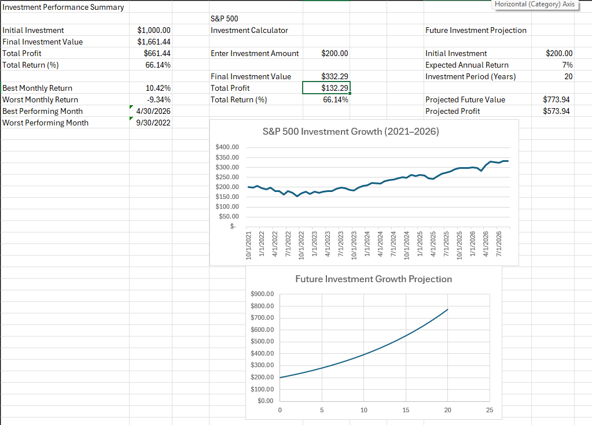
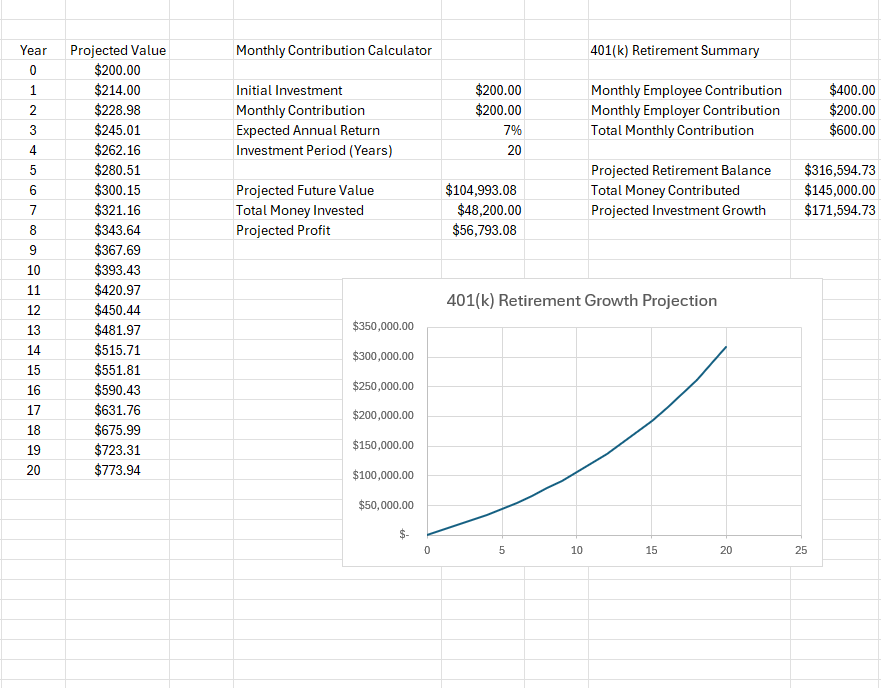
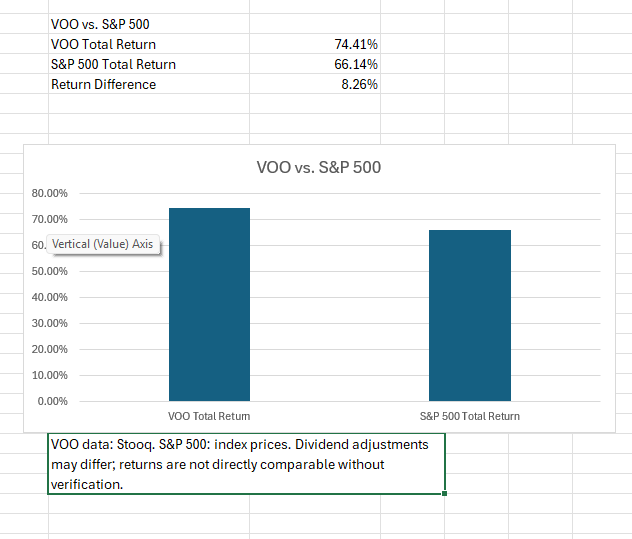

# Investment Portfolio & Retirement Analysis | Excel

## Project Overview

This project analyzes historical investment performance and models long-term investment and retirement growth using Microsoft Excel.

The goal was to transform historical financial data into an interactive workbook that helps users understand investment returns, compare market performance, and explore different savings and retirement scenarios.

## Tools and Skills

- **Microsoft Excel:** Data cleaning, formulas, tables, and charts
- **Financial Analysis:** Monthly returns, total returns, and investment growth
- **Excel Functions:** IF, ISNUMBER, FV, MAX, MIN, and cell references
- **Data Visualization:** Historical trends, growth projections, and performance comparisons
- **Scenario Analysis:** Investment contributions, expected returns, and retirement timelines

## Data

The workbook uses monthly historical data for:

- S&P 500 index
- Vanguard S&P 500 ETF (VOO)

**Analysis period:** October 2021 – September 2026.

VOO historical prices were sourced from Stooq.

## Key Features

### 1. Historical Investment Performance

- Calculated monthly percentage returns
- Identified best- and worst-performing months
- Calculated investment profit and total return
- Visualized historical investment growth

### 2. Investment Growth Calculator

Allows users to enter an initial investment amount and estimate its value using historical performance.

### 3. Future Investment Projection

Models investment growth using an assumed annual rate of return and an investment horizon.

### 4. Monthly Contribution Calculator

Estimates the future value of an investment using an initial deposit, recurring monthly contributions, and an assumed rate of return.

### 5. 401(k) Retirement Calculator

Models retirement savings using:

- Current retirement balance
- Annual salary
- Employee contribution percentage
- Employer matching percentage
- Expected annual return
- Years until retirement

### 6. VOO vs. S&P 500 Comparison

Compares calculated historical returns for the two datasets and displays the results in a column chart.

## Key Findings

| Metric | Result |
|---|---:|
| S&P 500 calculated return | 66.14% |
| VOO calculated return | 74.41% |
| Difference between calculated returns | 8.26 percentage points |
| Example 401(k) projected balance | $316,594.73 |
| Example 401(k) investment growth | $171,594.73 |

These results reflect the historical data and scenario assumptions used in the workbook.

## Limitations

- Historical returns do not guarantee future performance.
- Forecasts use assumed rates of return rather than predicting actual market movements.
- VOO and S&P 500 historical prices may use different dividend-adjustment conventions. Their reported returns should not be interpreted as a like-for-like total-return comparison without further verification.
- Retirement projections exclude taxes, fees, inflation, and other real-world factors unless specifically modeled.

## Future Improvements — Version 2.0

- Compare individual stocks, ETFs, bonds, CDs, REITs, and savings accounts
- Add annualized return and volatility metrics
- Include inflation-adjusted retirement projections
- Expand the investment dashboard
- Explore a web or mobile calculator

## Project Purpose

This project demonstrates practical Excel-based data analytics skills, including financial data preparation, analytical calculations, scenario modeling, data visualization, and communicating findings and limitations.

## Dashboard Screenshots

### S&P 500 Performance and Investment Growth

### Monthly Contributions and Retirement Projection

### VOO vs. S&P 500 Comparison

